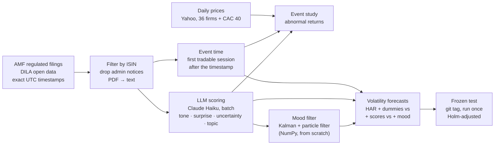
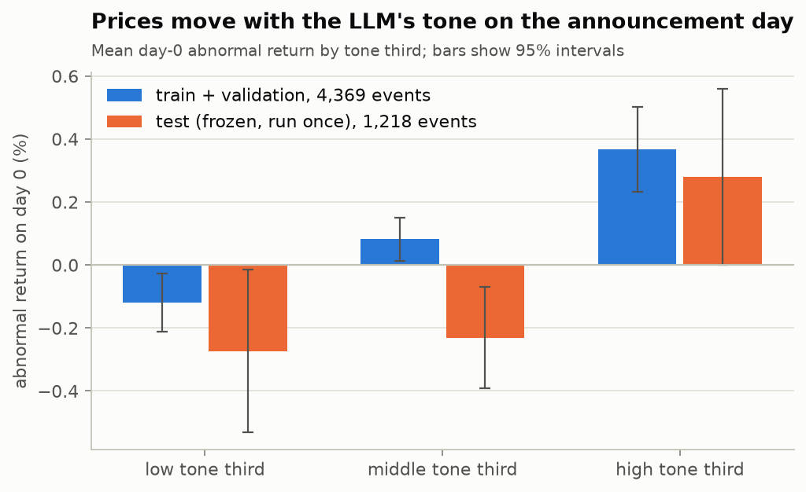
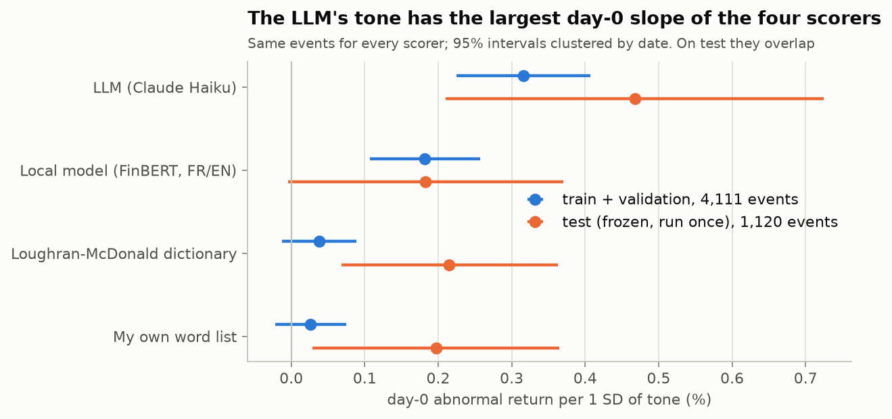
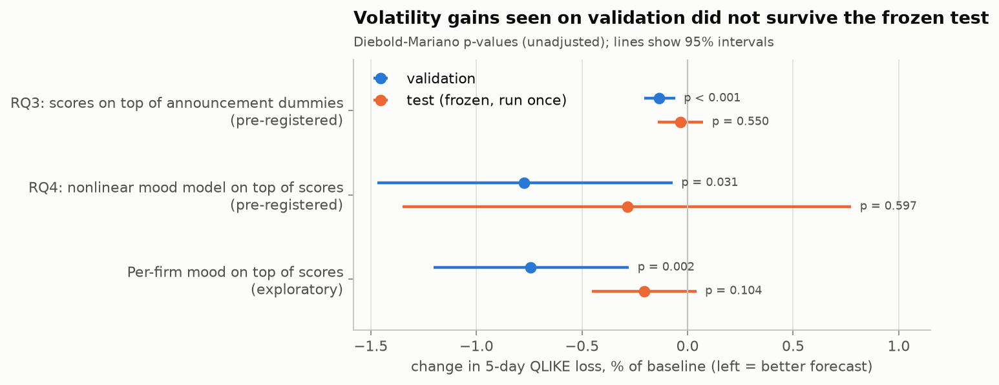
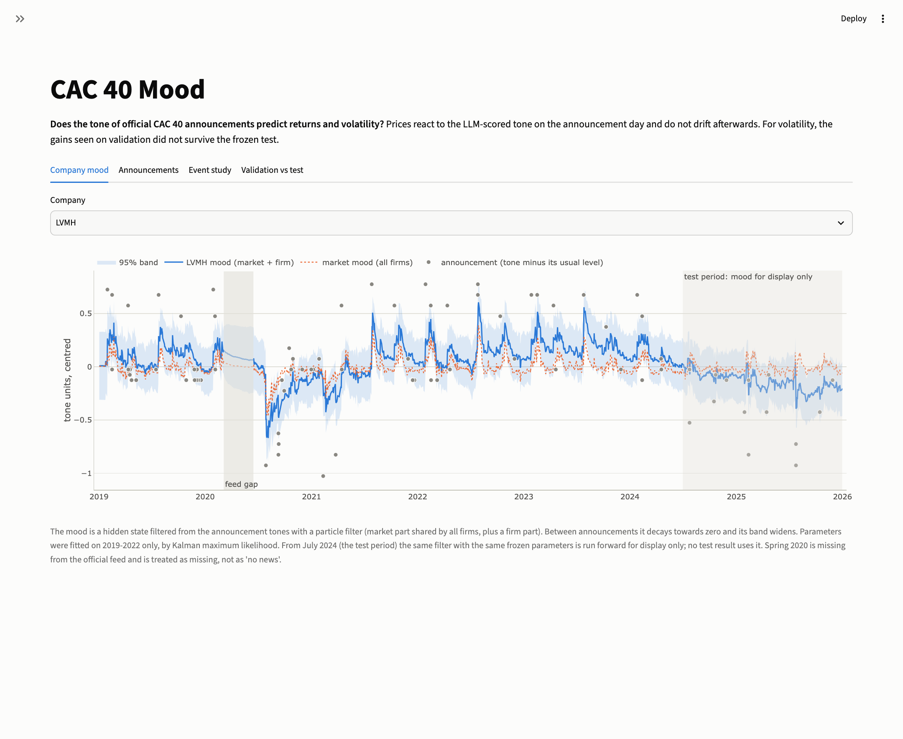
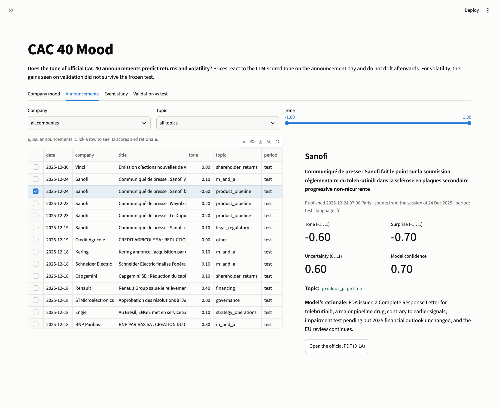
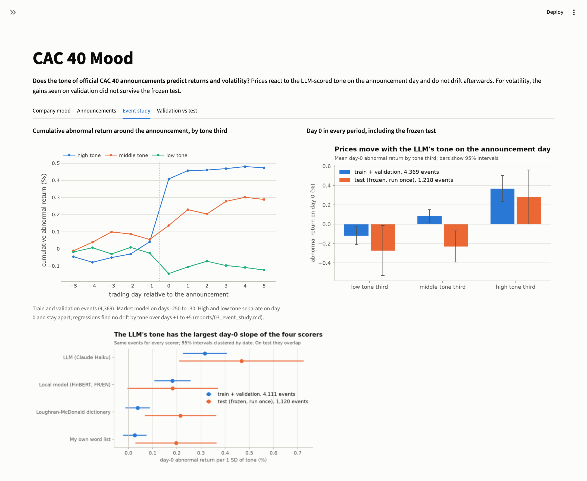
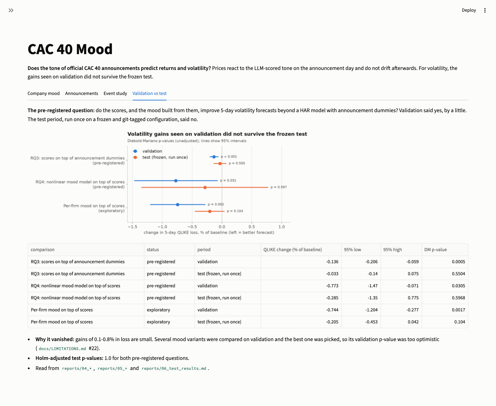

# CAC 40 Mood

**An LLM reading official CAC 40 announcements captures how prices move on the day, but it does not
help forecast volatility: the small gain seen on validation was gone on the frozen test.**

*Research project: 36 firms, 2019–2025, 6,996 scored filings, $5.26 total API spend. Everything
below is from the reports in [`reports/`](reports/); summary in
[`docs/FINDINGS.md`](docs/FINDINGS.md).*

**Live demo: [cac40-mood.streamlit.app](https://cac40-mood.streamlit.app/)**: company mood,
announcement viewer, event study and validation vs test, running on saved results.

## The question

Does the tone of official announcements (results, M&A, guidance, legal news…) predict

1. the **abnormal return** on the day and in the week after, and above all
2. **future volatility**, beyond what a standard HAR volatility model plus "an announcement of
   this type happened" already predicts?

The second control matters: results days are volatile whatever they say. Tone has to add
something on top of that.

## Data and pipeline



- **Announcements:** 7,223 non-administrative filings of 36 CAC 40 firms from the French
  regulator's official feed, timestamped to the minute. A filing counts from the **first trading
  session after its latest timestamp** (after 17:30 or on a holiday → next session), so no
  look-ahead.
- **Split:** train 2019–2022 · validation 2023 to June 2024 · **test July 2024 to 2025**. All tuning
  on train/validation. The test was run **once**, on the git tag
  [`phase6-freeze`](docs/PHASE6_PLAN.md), with the two hypotheses fixed in advance.
- **Volatility:** pooled HAR on Garman-Klass range variance, compared out of sample with QLIKE and
  Diebold-Mariano tests (Newey-West). Event study: market model, errors clustered by date.
- **Mood:** a hidden state per firm (market + firm part) filtered from the irregularly timed
  scores. Parameters by exact Kalman maximum likelihood on train; filtering with a vectorised
  bootstrap particle filter written in NumPy, checked against the Kalman filter on simulated data.
  A nonlinear variant lets the mood drive log-volatility (pre-registered as RQ4).

## Can the LLM scores be trusted?

Checked three ways before any result was looked at:

| Check | What it compares | Result |
|---|---|---|
| **Stronger model** | Haiku vs Claude Sonnet, 50 filings, same prompt | tone correlation 0.92, same topic on 90% |
| **My blind labels** | 40 filings I labelled without seeing any score | tone rank correlation **0.43**; the LLM is far more conservative (it calls small good news "neutral", by design of the prompt); opposite signs on 2 of 40 |
| **Memory / hindsight** | 100 filings re-scored with names and years hidden | scores barely move (tone correlation 0.97), **but** the model still recognised the firm in 83% of them, so the check is **inconclusive** |

Honest reading: the scores are stable and consistent with a stronger model, they measure
"material news for shareholders" rather than "positive wording", and hindsight cannot be ruled out
on a 2019–2025 sample ([`reports/02_gold_agreement.md`](reports/02_gold_agreement.md),
[`reports/02_memory_check.md`](reports/02_memory_check.md)).

## Results

**1. Prices move with the tone on the announcement day, in every period, including the test.**
The high and low tone thirds are about 0.5 percentage points apart on day 0. Days +1 to +5 show
no drift in any period, as an efficient market predicts.



**2. The LLM beats the cheap baselines on the day-0 move.** Its tone has the largest slope of four
scorers: a French/English FinBERT model, my own word list and the Loughran-McDonald finance
dictionary. On the smaller test sample the intervals overlap, so "largest" is not "significantly
larger" there. Cost of the full LLM scoring run: $2.47.



**3. Volatility: the pre-registered hypotheses were not confirmed.**



| Pre-registered, h = 5 days | Validation | Test (frozen, run once) |
|---|---|---|
| RQ3: scores add to announcement dummies | −0.14% QLIKE, p < 0.001 | −0.03%, p = 0.55 |
| RQ4: mood model adds to the scores | −0.77%, p = 0.03 | −0.29%, p = 0.60 |
| Holm-adjusted test p-value | | 1.0 and 1.0 |

## What didn't work, and why

- **The validation gain vanished on the test.** The gains were tiny (0.1–0.8% of the loss) and,
  for the mood, the winning variant was picked among several tried on validation, so its
  validation p-value was too optimistic. Fixing the hypothesis and the configuration before the
  test (git tag, one run) is exactly what exposed this.
- **The mood does not drive volatility.** In the nonlinear model the fitted link from mood to
  log-volatility was essentially zero (β = 0.0004). The particle filter itself worked (median
  effective sample size 3,503 of 5,000) but there was nothing for it to find.
- **GARCH-X** on ten firms: adding announcement and score columns made forecasts slightly worse.
- **Takeaway:** an LLM reads news well enough to explain *the reaction to it*, but once a good
  volatility model knows that an announcement happened, *what it said* adds no measurable
  forecasting power at daily frequency.

## Limitations

The full list (25 items) is in [`docs/LIMITATIONS.md`](docs/LIMITATIONS.md). The ones that matter
most:

- **Survivorship:** today's index members only; Airbus, ArcelorMittal and Stellantis file abroad
  and are missing; URW has no usable price history.
- **Hindsight in the LLM** cannot be excluded (see the memory check). The clean test would use
  filings published after the model's training cut-off.
- **Daily data:** 22% of filings arrive during trading hours; intraday prices would sharpen the
  event study. March–June 2020 is missing from the official feed.
- **Gold set:** one labeller, 40 documents, definitions not identical to the prompt's.

## Dashboard

Live at **[cac40-mood.streamlit.app](https://cac40-mood.streamlit.app/)**, or locally with
`uv run streamlit run app/main.py`: per-company mood with its 95% band and announcements, an
announcement viewer (scores, the model's one-line rationale and a link to the official PDF), the
event study and the validation-vs-test panel. It reads saved results only and makes no API calls.

| | |
|---|---|
|  |  |
|  |  |

It runs on the small public bundle of derived results in [`public_data/`](public_data/) (scores,
rationales, mood series, aggregate tables; no prices, no filing texts), so it works on a fresh
clone. The mood from July 2024 on is the same frozen filter run forward **for display only**; no
test result uses it.

## How to run it

```bash
uv sync --all-groups
uv run pytest -m "not network"                      # tests, offline
uv run python -m cac40_mood.readme_figures         # README charts, from reports/ only
uv run streamlit run app/main.py                   # dashboard, from public_data/ and reports/
```

Rebuilding the data and scores from scratch (downloads, an Anthropic API key, about $5 and a few
hours): step by step in [`docs/RUN.md`](docs/RUN.md). Without `uv`: `pip install -r requirements.txt`.

## Cost

| | USD |
|---|---|
| Bulk scoring, 6,996 filings (Claude Haiku, Batches API) | 2.47 |
| Prompt pilots, Sonnet comparison, firm-size extraction, memory check | 2.79 |
| **Total API spend** (hard cap in the code: $30) | **5.26** |

Every response is cached on disk by a hash of the full request, so nothing is ever paid for twice.

## Repository

```
src/cac40_mood/   package: data/, scoring/, events/, vol/, mood/, phase6.py
tests/            pytest (event-time alignment, no look-ahead, CARs, Kalman and particle filter)
app/              Streamlit dashboard (main.py) and the gold-set labelling page
public_data/      derived results the dashboard runs on (no prices, no filing texts)
reports/          every result as it was produced; figures/
docs/             findings, limitations, data sources and licences, run guide
```

Design decisions, each with its reason: [`DECISIONS.md`](DECISIONS.md). Plan and phases:
[`PLAN.md`](PLAN.md).

## Data and licences

Code: MIT ([`LICENSE`](LICENSE)). Derived results in [`public_data/`](public_data/): CC BY 4.0.
Filing metadata: DILA, info-financière (https://www.info-financiere.gouv.fr), data received from
the AMF, reused under the Licence Ouverte / Open Licence 2.0 (Etalab). **Not distributed:** the
filings' texts (the issuers' documents; the dashboard links to the official PDF), prices (Yahoo
Finance, personal use only) and the Loughran-McDonald dictionary (academic use only). Details:
[`docs/DATA_SOURCES.md`](docs/DATA_SOURCES.md) §11.
