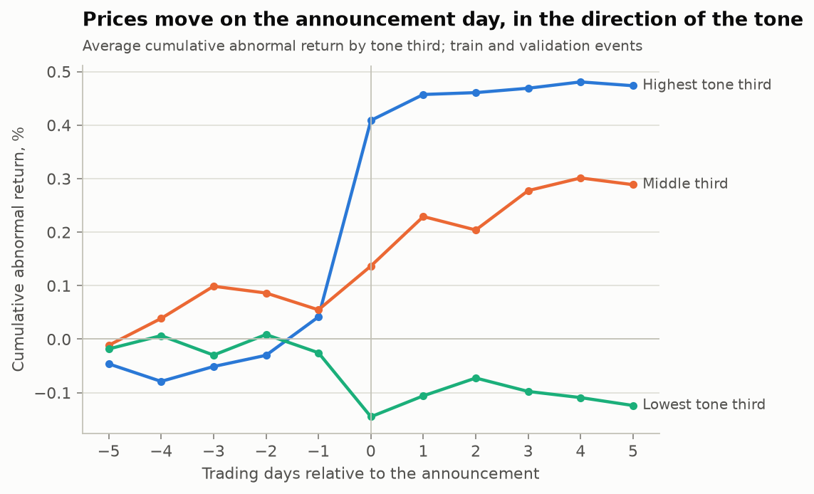

# Event study with the scores (train and validation)

4,384 firm-day events of 36 firms, 4,369 with a complete window.
Abnormal return = return minus the market-model prediction (estimated on days -250 to
-30). Returns are in log points: 0.01 is about 1%. Standard errors are clustered by
event date. All of this is exploratory; `bh_p_value` is the Benjamini-Hochberg
adjustment across the rows of the first table.

## Scores and abnormal returns

Coefficient = change in the CAR for a tone (or surprise, uncertainty) higher by 1.
Controls: released during trading hours, volatility before the event, log revenue,
topic dummies.

| outcome | specification | regressor | coefficient | ci_low | ci_high | t | p_value | bh_p_value | n |
|---|---|---|---|---|---|---|---|---|---|
| CAR[0] (RQ1) | tone only | tone | 0.0117 | 0.0082 | 0.0152 | 6.5944 | 0.0 | 0.0 | 4369 |
| CAR[0] (RQ1) | scores + controls | tone | 0.0001 | -0.0056 | 0.0058 | 0.0314 | 0.975 | 0.975 | 4369 |
| CAR[0] (RQ1) | scores + controls | surprise | 0.025 | 0.0141 | 0.0358 | 4.5027 | 0.0 | 0.0 | 4369 |
| CAR[0] (RQ1) | scores + controls | uncertainty | 0.0027 | -0.0023 | 0.0078 | 1.0624 | 0.2881 | 0.4285 | 4369 |
| CAR[+1,+5] (RQ2) | tone only | tone | -0.0018 | -0.0056 | 0.002 | -0.9434 | 0.3455 | 0.4285 | 4369 |
| CAR[+1,+5] (RQ2) | scores + controls | tone | -0.0029 | -0.0097 | 0.0038 | -0.8546 | 0.3928 | 0.4285 | 4369 |
| CAR[+1,+5] (RQ2) | scores + controls | surprise | 0.006 | -0.0046 | 0.0167 | 1.1156 | 0.2646 | 0.4285 | 4369 |
| CAR[+1,+5] (RQ2) | scores + controls | uncertainty | 0.0079 | 0.0003 | 0.0154 | 2.0459 | 0.0408 | 0.1007 | 4369 |
| CAR[-5,-1] (placebo) | tone only | tone | 0.0017 | -0.0021 | 0.0054 | 0.8756 | 0.3812 | 0.4285 | 4369 |
| CAR[-5,-1] (placebo) | scores + controls | tone | -0.0074 | -0.0146 | -0.0003 | -2.0308 | 0.0423 | 0.1007 | 4369 |
| CAR[-5,-1] (placebo) | scores + controls | surprise | 0.016 | 0.0036 | 0.0284 | 2.5347 | 0.0113 | 0.045 | 4369 |
| CAR[-5,-1] (placebo) | scores + controls | uncertainty | -0.0085 | -0.017 | 0.0 | -1.9569 | 0.0504 | 0.1007 | 4369 |

## Average CAR by tone third

| outcome | tone_tercile | events | mean | std_error | t |
|---|---|---|---|---|---|
| CAR[0] (RQ1) | low | 1462 | -0.0012 | 0.00047 | -2.52533 |
| CAR[0] (RQ1) | middle | 1531 | 0.00082 | 0.00035 | 2.35926 |
| CAR[0] (RQ1) | high | 1376 | 0.00367 | 0.00069 | 5.35956 |
| CAR[+1,+5] (RQ2) | low | 1462 | 0.00021 | 0.00076 | 0.27734 |
| CAR[+1,+5] (RQ2) | middle | 1531 | 0.00152 | 0.00075 | 2.02553 |
| CAR[+1,+5] (RQ2) | high | 1376 | 0.00065 | 0.00076 | 0.85744 |
| CAR[-5,-1] (placebo) | low | 1462 | -0.00025 | 0.00081 | -0.31145 |
| CAR[-5,-1] (placebo) | middle | 1531 | 0.00055 | 0.00076 | 0.72381 |
| CAR[-5,-1] (placebo) | high | 1376 | 0.00042 | 0.00072 | 0.57729 |

## Tone alone, in sub-samples

| sample | outcome | coefficient | ci_low | ci_high | t | p_value | n |
|---|---|---|---|---|---|---|---|
| all events | CAR[0] (RQ1) | 0.0117 | 0.0082 | 0.0152 | 6.5944 | 0.0 | 4369 |
| all events | CAR[+1,+5] (RQ2) | -0.0018 | -0.0056 | 0.002 | -0.9434 | 0.3455 | 4369 |
| not during trading hours | CAR[0] (RQ1) | 0.0135 | 0.0094 | 0.0176 | 6.4936 | 0.0 | 3411 |
| not during trading hours | CAR[+1,+5] (RQ2) | -0.0021 | -0.0064 | 0.0023 | -0.9359 | 0.3493 | 3411 |
| from 2020-07-01 | CAR[0] (RQ1) | 0.0105 | 0.0066 | 0.0143 | 5.2689 | 0.0 | 3432 |
| from 2020-07-01 | CAR[+1,+5] (RQ2) | -0.0032 | -0.0075 | 0.0011 | -1.4711 | 0.1413 | 3432 |
| train period | CAR[0] (RQ1) | 0.0113 | 0.0075 | 0.0151 | 5.8681 | 0.0 | 3138 |
| train period | CAR[+1,+5] (RQ2) | -0.0016 | -0.0061 | 0.0029 | -0.6929 | 0.4884 | 3138 |
| validation period | CAR[0] (RQ1) | 0.013 | 0.0049 | 0.0212 | 3.1358 | 0.0017 | 1231 |
| validation period | CAR[+1,+5] (RQ2) | -0.0029 | -0.0099 | 0.0041 | -0.8024 | 0.4223 | 1231 |

## Which scorer's tone goes with the day-0 return? (RQ5)

Slope = change in CAR[0] for a tone one standard deviation higher. Only events that
every scorer has a tone for (Loughran-McDonald needs an official English version).

| scorer | coefficient | ci_low | ci_high | t | p_value | r_squared | n |
|---|---|---|---|---|---|---|---|
| LLM | 0.00316 | 0.00225 | 0.00407 | 6.79334 | 0.0 | 0.02459 | 4111 |
| Local model | 0.00182 | 0.00107 | 0.00257 | 4.76016 | 0.0 | 0.00814 | 4111 |
| Lexicon | 0.00026 | -0.00022 | 0.00075 | 1.06835 | 0.28536 | 0.00017 | 4111 |
| Loughran-McDonald | 0.00038 | -0.00013 | 0.00089 | 1.46944 | 0.14171 | 0.00036 | 4111 |

## Gold documents: my labels against the LLM (indicative only)

The 40 hand-labelled documents, matched to their firm-day. With about 40 events
neither row can be told apart from zero or from the other; read it as a hint.

| scorer | coefficient | ci_low | ci_high | t | p_value | spearman_with_car_0 | n |
|---|---|---|---|---|---|---|---|
| My label | 0.0027 | -0.00282 | 0.00822 | 0.9587 | 0.33771 | -0.00394 | 35 |
| LLM tone | 0.00505 | -0.001 | 0.0111 | 1.63692 | 0.10165 | 0.15548 | 35 |
